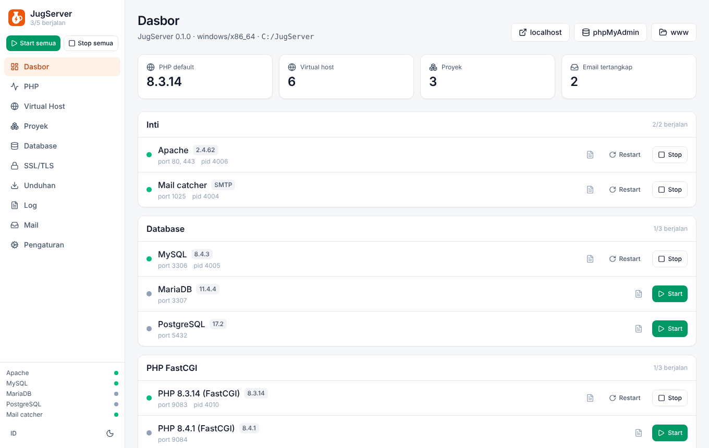
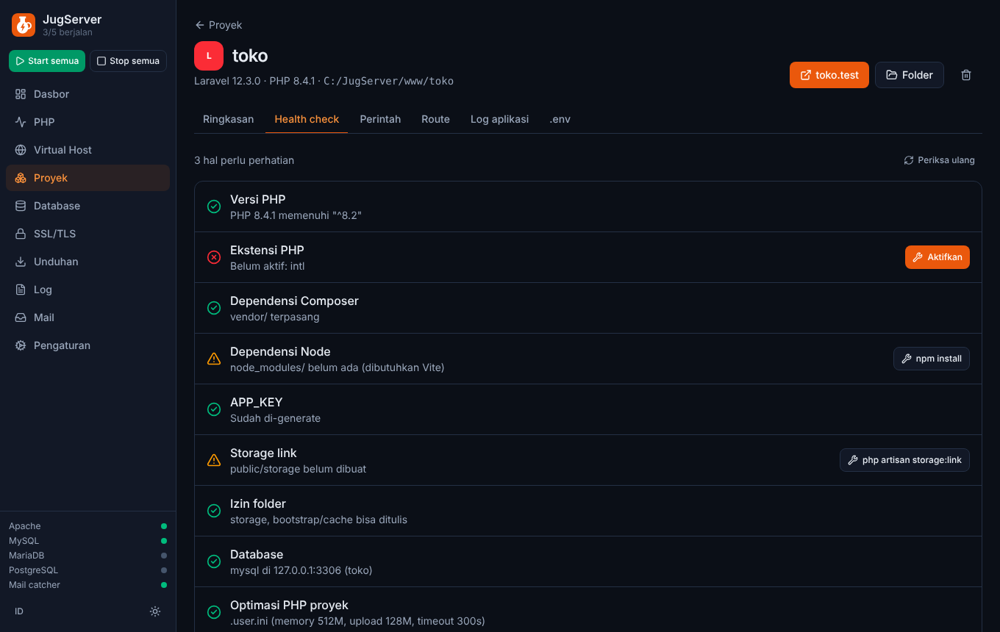
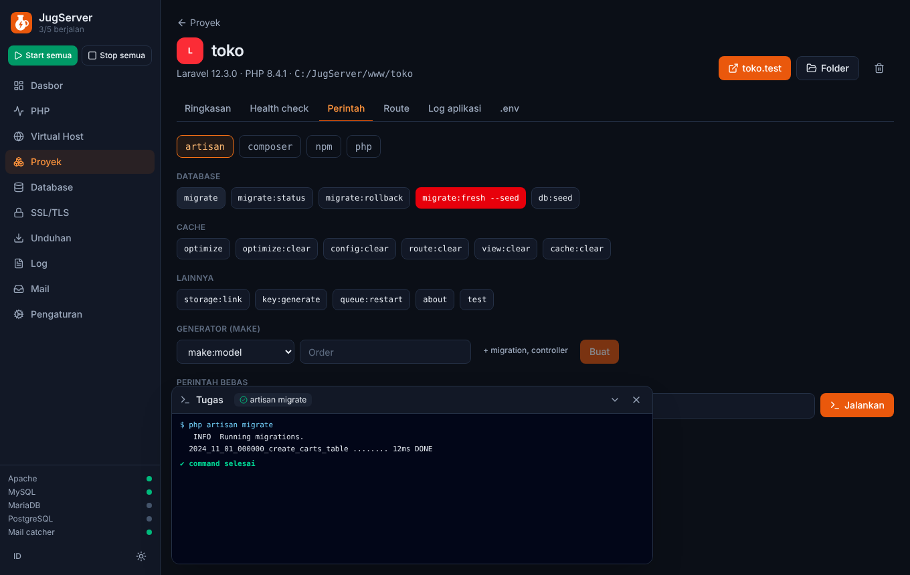
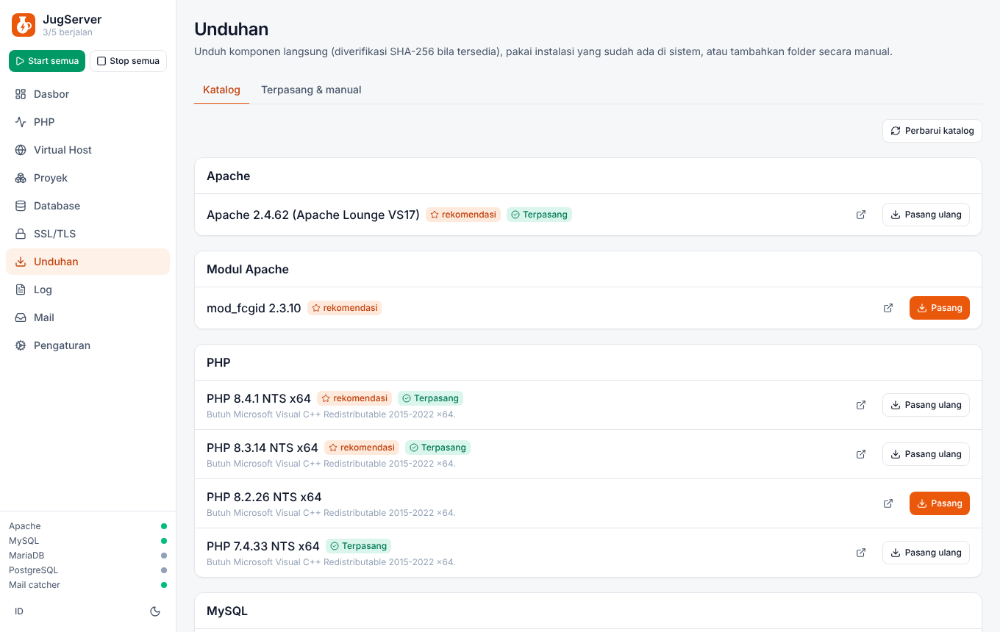
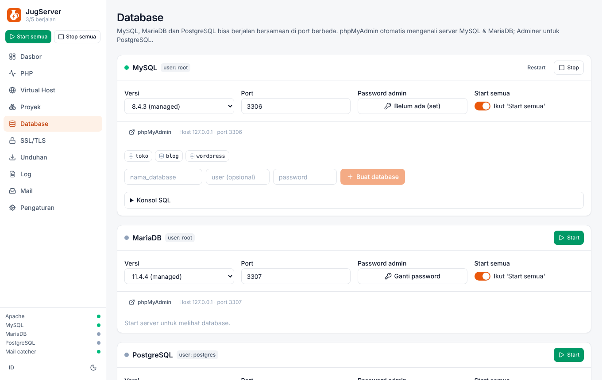
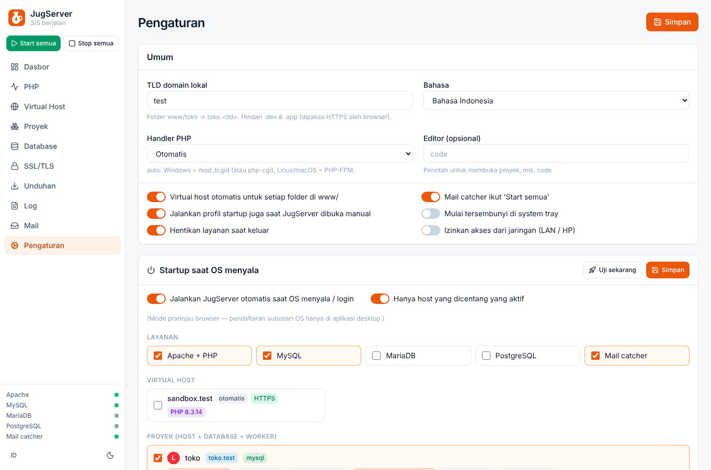
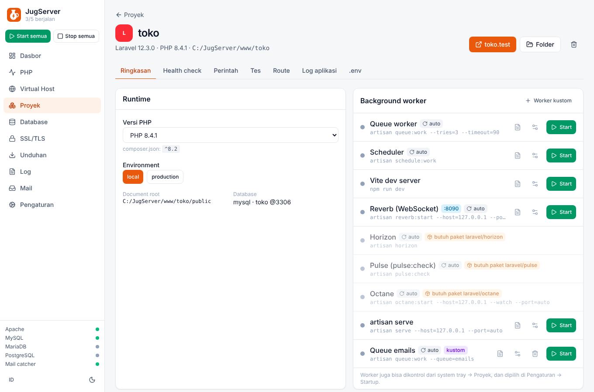
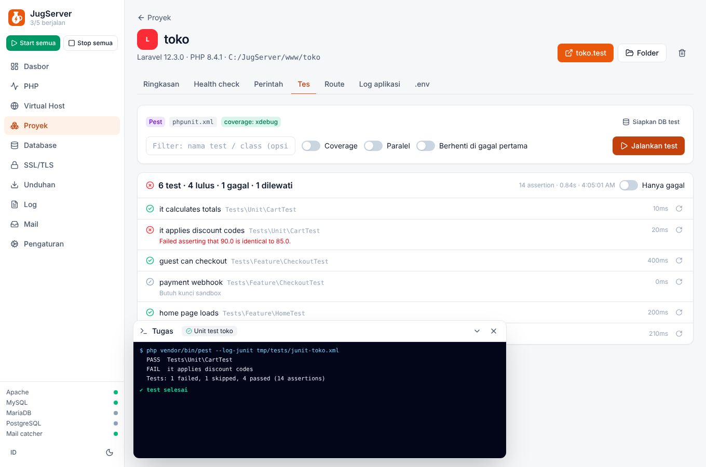
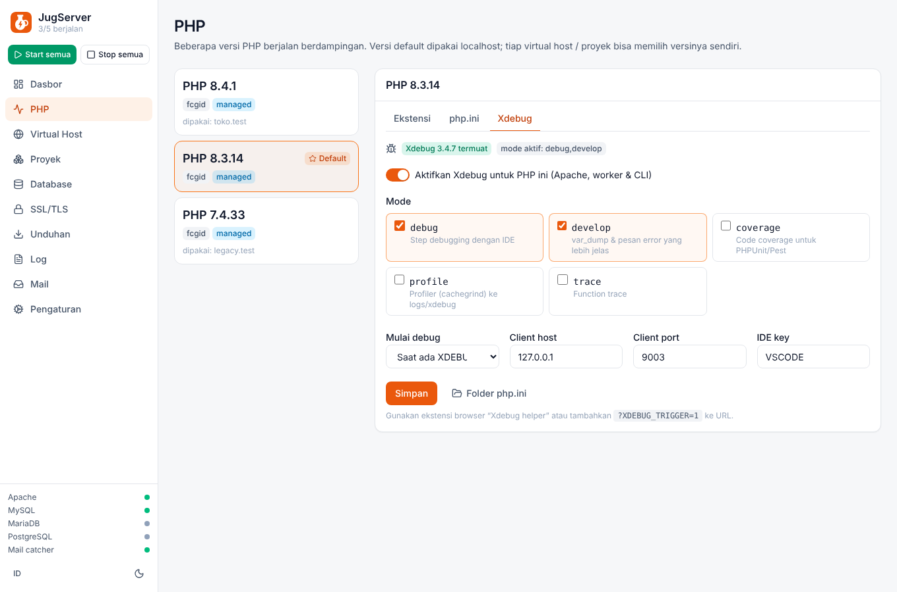

# 🍶 JugServer

Pengelola **web server lokal** lintas platform (Windows · Linux · macOS) — alternatif modern WampServer/XAMPP/Laragon dengan UI **Next.js/React** dan backend **Rust** (aplikasi desktop **Tauri v2**, ringan ±10 MB).



## Fitur

| Fitur | Keterangan |
|---|---|
| **Multi-versi PHP** | Banyak versi berjalan berdampingan. Ganti default sekali klik (UI/tray), atau pilih versi **per virtual host / per proyek**. Editor `php.ini`, toggle ekstensi, preset direktif (memory, upload, timezone…), Xdebug. |
| **Virtual host & alias** | Folder di `www/` otomatis jadi `folder.test` (docroot `public/` terdeteksi). Vhost manual untuk folder di mana saja, server alias, alias direktori (`/docs → D:/dokumentasi`). File `hosts` diperbarui otomatis (UAC/pkexec/osascript). |
| **Database** | MySQL, MariaDB & PostgreSQL bisa jalan **bersamaan**, port bisa diatur, inisialisasi data dir otomatis, ganti password root/postgres, buat/hapus database & user, konsol SQL. |
| **phpMyAdmin & Adminer** | Di-serve di `/phpmyadmin` & `/adminer`; `config.inc.php` otomatis mendaftarkan server MySQL & MariaDB sesuai port. Adminer untuk PostgreSQL. |
| **Kontrol layanan & system tray** | Start/stop/restart Apache, PHP-FPM/FastCGI, database, worker; tray dengan status warna, ganti versi PHP, buka localhost/phpMyAdmin/folder, buka log error. |
| **SSL/TLS lokal** | CA lokal + sertifikat per domain (termasuk `*.domain`), mod_ssl dikonfigurasi otomatis, tombol "Percayai CA" (Windows Trusted Root tanpa UAC, keychain macOS, store Linux + NSS). |
| **Unduhan & tambah manual** | **Rilis terdeteksi otomatis** dari situs resmi tiap tool (diperiksa di latar belakang tiap 24 jam, atau tombol "Perbarui katalog"): Apache Lounge (+SHA-256), windows.php.net (+SHA-256), static-php.dev, MariaDB REST API (+SHA-256), MySQL (endoflife.date + CDN), PostgreSQL (versions.json + EDB), phpMyAdmin, Composer, Adminer. File unduhan divalidasi (menolak halaman error/HTML), progres & cache; install dari URL/arsip lokal; **deteksi instalasi yang sudah ada** (apt/dnf/brew, XAMPP, WampServer, Laragon, Postgres.app); tambah folder manual. |
| **Log** | Viewer log real-time (Apache, PHP, DB, aplikasi) dengan filter. |
| **Mail catcher** | Server SMTP lokal (port 1025) — email aplikasi ditangkap dan ditampilkan (HTML/teks/header/sumber). |
| **Startup saat OS menyala** | Daftar ke autostart OS (Windows Run, macOS LaunchAgent, Linux `.desktop`). Checklist layanan (Apache, MySQL, MariaDB, PostgreSQL, Mail), virtual host dan proyek (beserta database & worker-nya). Opsi "hanya host tercentang yang aktif" — host lain nonaktif sampai diaktifkan dari UI/tray. |
| **Xdebug** | Status per versi PHP, pasang sekali klik (DLL xdebug.org di Windows, apt/dnf/pecl di Linux/macOS), mode debug/develop/coverage/profile/trace, host/port/IDE key, `.vscode/launch.json`, tombol buka dengan `XDEBUG_TRIGGER`. |

### ⭐ Fitur khusus Laravel & CodeIgniter

- **Buat proyek sekali klik** — Laravel 10/11/12, CodeIgniter 4, CodeIgniter 3 via Composer dengan PHP milik proyek. Otomatis: virtual host (+HTTPS) dengan docroot benar, database dibuat, `.env`/config ditulis (DB, `APP_URL`/`app.baseURL`, SMTP ke mail catcher), `key:generate`, `storage:link`, `migrate`, `.htaccess` (CI3), izin folder.
- **Import proyek** yang sudah ada — framework, versi & constraint PHP (`composer.json`) terdeteksi; versi PHP terpasang yang cocok dipilih otomatis.
- **Health check + perbaikan sekali klik** — versi PHP vs `composer.json`, ekstensi wajib (aktifkan langsung), `vendor/`, `node_modules/`, `.env`/`APP_KEY`, storage link, config cache, izin `storage/`·`bootstrap/cache`·`writable/`, koneksi database, vhost.
- **Panel perintah** artisan / spark / composer / npm (migrate, seed, cache, generator `make:*`, perintah bebas) dengan output live.
- **Background worker** sebagai layanan terkelola: `queue:work` (argumen bisa diatur, mis. `--queue=emails`), `schedule:work`, Vite, Reverb, Horizon, Pulse, Octane, `artisan serve`/`spark serve`, plus **worker kustom** (`queue:listen`, dll.). Port Reverb/Octane/serve dipilih otomatis tanpa bentrok (Reverb `.env` ikut diperbarui), **auto-restart** dengan backoff bila crash, log per worker. Worker hanya aktif bila paketnya terpasang.
- **Pasang paket Laravel** sekali klik: Reverb, Horizon, Telescope, Pulse, Octane (RoadRunner), API + Sanctum.
- **Unit test**: deteksi Pest/PHPUnit, jalankan (filter, paralel, stop-on-failure), hasil terstruktur dari JUnit (lulus/gagal/dilewati, pesan & stack, jalankan ulang satu test), **coverage** (Clover + laporan HTML) via Xdebug/PCOV, tombol "Siapkan DB test" (`<db>_test`, `.env.testing` / `database.tests.*`).
- **Route viewer** (`route:list --json` / `spark routes`), **log aplikasi** terparsir (stack trace dapat dibuka), **editor .env**, toggle environment (local/production, `CI_ENVIRONMENT`, `ENVIRONMENT` CI3).
- **Optimasi otomatis**: `.user.ini` per proyek (memory 512M, upload 128M, timeout 300s), OPcache dev-friendly, `AllowOverride All` + `mod_rewrite`.

## Dukungan OS

| | Windows | Linux | macOS |
|---|:-:|:-:|:-:|
| Apache + multi PHP | ✅ mod_fcgid / php-cgi (unduh langsung) | ✅ PHP-FPM (apt/dnf atau build statis) | ✅ PHP-FPM (brew atau build statis) |
| Unduh Apache dari aplikasi | ✅ | ➖ pakai paket sistem (terdeteksi otomatis) | ➖ brew (terdeteksi otomatis) |
| MySQL / MariaDB / PostgreSQL | ✅ unduh | ✅ unduh (MySQL/MariaDB) / sistem | ✅ unduh / brew / Postgres.app |
| Impor XAMPP/WampServer/Laragon | ✅ | – | MAMP |
| Install sebagai Windows Service | ✅ | – | – |
| Port 80/443 | ✅ | ✅ (tombol `setcap`) | ✅ |
| Start bersama OS, tray, SSL, mail, framework tools | ✅ | ✅ | ✅ |

Windows adalah platform dengan fitur paling lengkap.

## Arsitektur

```
JugServer/
├── ui/                        Next.js 15 (App Router, static export) + Tailwind v4
├── src-tauri/                 Shell desktop Tauri v2: window, system tray, bridge `invoke("api")`
├── crates/jugserver-core/     Engine Rust: layanan, PHP, vhost, SSL, unduhan, DB, framework, mail
│   └── templates/             httpd.conf, vhosts.conf, my.cnf, php-fpm.conf, phpMyAdmin config
├── crates/jugserver-cli/      CLI headless `jugserver` (engine yang sama)
└── catalog/catalog.json       Katalog unduhan (bisa diperbarui dari repo)
```

- UI memanggil satu perintah Tauri `api(method, args)` → `jugserver_core::api::dispatch`. Event (status layanan, output tugas, progres unduhan, log, email) dikirim lewat `jug://event`.
- Status proses disimpan sebagai pidfile di `run/`, sehingga aplikasi desktop dan CLI berbagi status.
- Data default: `C:\JugServer` (Windows) atau `~/JugServer`; ubah dengan `JUGSERVER_HOME`.

```
JugServer/  bin/<jenis>/<versi>  apps/phpmyadmin  www/  etc/apache|php|mysql  data/  logs/  ssl/  run/  tmp/
```

## Pengembangan

Prasyarat: Rust stable, Node.js 20+, dan di Linux: `libwebkit2gtk-4.1-dev libgtk-3-dev libayatana-appindicator3-dev librsvg2-dev`.

Repo memakai npm workspaces (`ui/` adalah workspace), jadi cukup satu kali install di root:

```bash
npm install
```

```bash
npm run dev
```

UI saja di browser (memakai data contoh/mock), server dev di **http://localhost:3384**:

```bash
npm run ui:dev
```

Build installer (MSI/NSIS di Windows, DMG di macOS, DEB/AppImage di Linux):

```bash
npm run build
```

Tes:

```bash
cargo test --workspace
```

## CLI

```bash
cargo run -p jugserver-cli -- status
```

Contoh lain: `jugserver startup show|run [--wait]`, `jugserver hosts-filter clear`, `jugserver project workers toko`, `jugserver project worker toko queue --args "--queue=emails"`, `jugserver project install toko reverb`, `jugserver project test toko --coverage`, `jugserver xdebug set php-8.3.14 --modes debug,coverage`, `jugserver start all`, `jugserver detect --register`, `jugserver install php-8.3.14-win-x64`, `jugserver vhost add toko.test D:/toko/public --ssl --alias /docs=D:/docs`, `jugserver db create mariadb toko`, `jugserver project new toko --framework laravel --db mysql`, `jugserver project health toko`, `jugserver project run toko artisan migrate`, `jugserver mail serve`.

## Catatan

- Katalog bawaan (`catalog/catalog.json`) hanya cadangan saat offline; versi terbaru diambil langsung dari situs resmi. Untuk memperbarui cadangan: `JUG_CATALOG_OUT=$PWD/catalog/catalog.json cargo test -p jugserver-core snapshot_catalog -- --ignored`.
- PHP Windows & Apache Lounge membutuhkan Microsoft Visual C++ Redistributable 2015-2022 x64.
- Hindari TLD `.dev`/`.app` (dipaksa HTTPS oleh browser); default `.test`.

## Akses dari HP / komputer lain (LAN)

1. *Pengaturan → Izinkan akses dari jaringan* → Simpan (Apache, database & SMTP mendengarkan di semua antarmuka).
2. Pilih **mode alamat** di *Pengaturan → Akses dari jaringan*:
   - **nip.io** — `http://toko.192.168.1.23.nip.io/`; tanpa setting di perangkat lain, butuh internet untuk DNS.
   - **Port per host (intranet)** — `http://192.168.1.23:8101/`; tiap host dapat port tetap (mulai 8100), tanpa DNS sama sekali, jalan offline.
   - **Nama domain (hosts / DNS lokal)** — `http://toko.test/`; salin baris hosts yang disediakan ke perangkat lain atau atur di DNS router/server intranet.
   Localhost/folder `www` selalu bisa dibuka lewat `http://192.168.1.23/`.
3. Windows: klik *Izinkan di firewall* (aturan untuk jaringan Private, termasuk rentang port mode *port per host*). Linux dengan ufw juga didukung.

## Pembaruan aplikasi

Cek versi otomatis saat dibuka dan halaman *Tentang*. Self-update bertanda tangan membutuhkan kunci updater + tempat file rilis — lihat [docs/UPDATER.md](docs/UPDATER.md). Rilis bisa lewat GitHub Actions (push tag `v*`) atau dari PC sendiri: `npm run release:local` lalu unggah hasilnya ke GitHub Releases.

## Halaman Tentang

Konten diambil dari [`docs/about.json`](docs/about.json) dan [`CHANGELOG.md`](CHANGELOG.md) (disalin ke UI saat dev/build) — edit file tersebut untuk memperbarui.

## Troubleshooting Windows

- `EPERM: operation not permitted, rmdir ...node_modules...` saat `npm install`: tutup editor/terminal yang menjalankan `next dev` atau `tauri dev`, hapus folder `node_modules` dan `ui\node_modules`, lalu jalankan `npm install` lagi dari root. Jika masih terjadi, kecualikan folder proyek dari pemindaian real-time Windows Defender (atau antivirus lain) yang sering mengunci file saat diekstrak.
- `Cannot find module '...\ui\node_modules\next\dist\bin\next'` saat `npm run dev`: sisa instalasi lama di `ui\node_modules` (sejak UI menjadi npm workspace, dependensi dipasang di `node_modules` root). Jalankan `npm run clean` lalu `npm install`.
- `Module not found` setelah `git pull`: `npm run dev` / `npm run build` kini otomatis menjalankan `npm install` bila `package-lock.json` berubah (`scripts/ensure-deps.mjs`); atau jalankan `npm install` manual.
- Peringatan `npm warn deprecated eslint@9...` aman diabaikan.

## Lisensi

MIT

## Tangkapan layar (data contoh)

| | |
|---|---|
|  |  |
|  |  |
|  |  |
|  |  |
